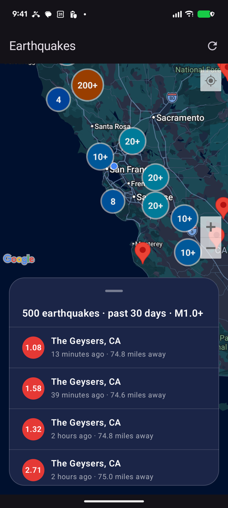
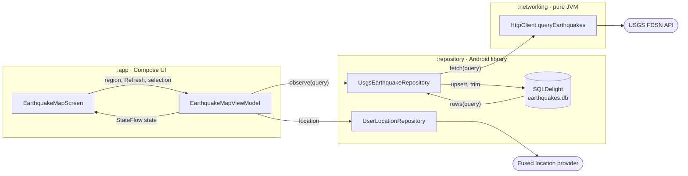

# Earthquakes

An Android app for exploring recent earthquakes around you, built with Kotlin and Jetpack Compose
on the [USGS earthquake API](https://earthquake.usgs.gov/fdsnws/event/1/).

The home screen is a map centred on your location, with a card listing the earthquakes in view.
Drag the card's handle (or tap it) to expand the list to full height. Tapping a row or a map pin
flies the map to that earthquake, hides every other pin, and shows its details in the same card: magnitude, time, depth,
coordinates and distance from you. Back returns you to the list, where you were.



## Setup

- Android Studio (recent stable) or the Android SDK command-line tools.
- JDK 17. If none is installed, Gradle downloads one on the first build.
- A Google Maps API key with **Maps SDK for Android** enabled.

Fill in the Maps api key in the build.gradle.kts file.

## Building and running

```sh
./gradlew :app:installDebug   # build and install on a connected device or emulator (API 26+)
./gradlew test                # all unit tests
```

Or open the project in Android Studio and run the `app` configuration. On first launch the app
asks for approximate location; everything works without it.

## Technical Decisions
- Koin for DI, because it's simple and works well with Compose.
- Ktor for networking, because it is the most idiomatic Kotlin HTTP client.
- SQLDelight for the offline database, because it generates type-safe Kotlin APIs from SQL.

## Trade-offs
- There is a large increase of code due to updating the bounds and displaying earthquakes based on the location of the map. Displaying items just in a list would have 
significantly reduced code.
- I reused the overlay card between both the main page and the details view, which made the code more complex than if I had just used a separate card for each. 
By doing this, we were able to remove the need for the navigation library and was also able to reuse the same `Google Map` component. This made the UI much more fluid, while introducing slightly more complexity.


## Architecture

The architecture of this app is inspired by [People In Space](https://github.com/joreilly/PeopleInSpace) and

Three Gradle modules in a strict line (`:app` → `:repository` → `:networking`), wired with Koin.
The database is the source of truth: the screen only shows its rows, and USGS's answers only
ever go into it.



- **`:networking`**: a Ktor client and `HttpClient.queryEarthquakes(EarthquakeQuery)` for the FDSN
  event query, plus the `@Serializable` GeoJSON models. The models declare only the fields the
  app reads, so unexpected changes elsewhere in the response can't break parsing.
- **`:repository`**: `EarthquakeRepository`, which owns the offline SQLite database (`cache/`), and user
  location (`location/`):
  `UserLocationRepository` holds a `StateFlow<UserLocation>` behind a `LocationProvider`
  interface, implemented with the fused location provider.
- **`:app`**: one screen (`map/`) with one ViewModel exposing `StateFlow` state; the details are a
  second state of the same card, so there's no navigation library.
